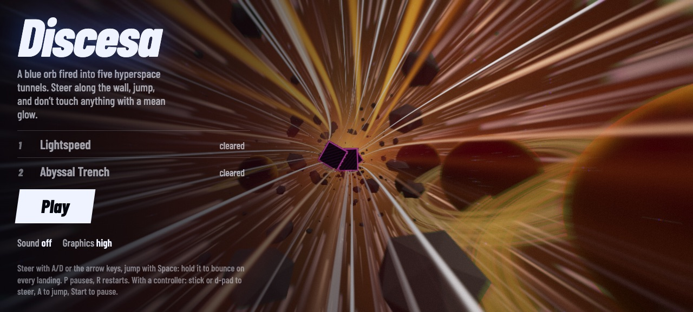
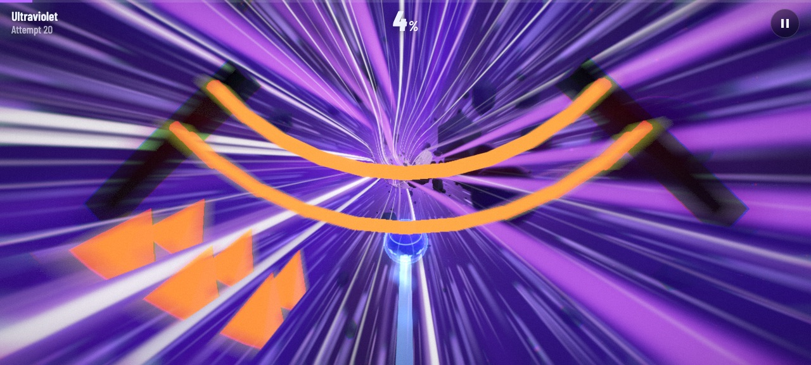
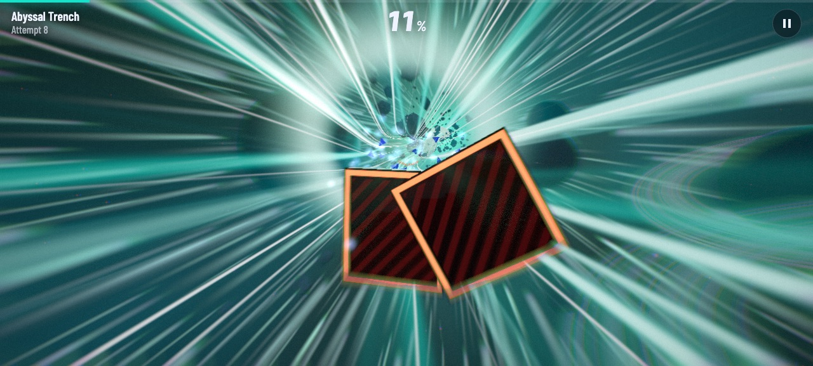
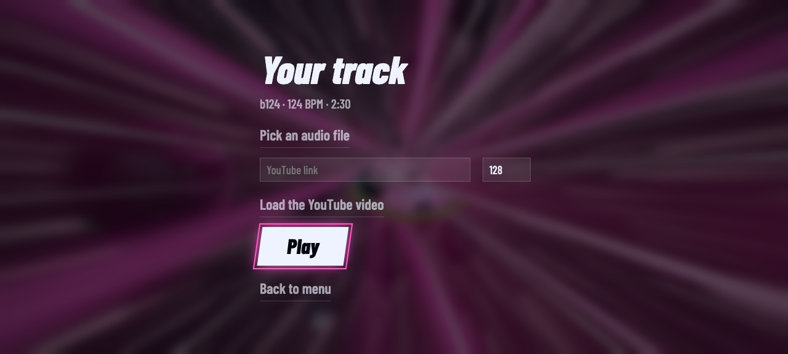

# Discesa

[](https://github.com/tcsenpai/discesa/actions/workflows/ci.yml)

Third-person 3D runner: a blue orb fired into five hyperspace tunnels.
Steer along the tube wall, jump, dodge everything with a mean glow.
Die, restart instantly. A sixth tunnel is built from your own music.

**[Play in the browser](https://tcsenpai.github.io/discesa/)** ·
**[Download the Android APK](https://github.com/tcsenpai/discesa/releases/latest)**



| | |
|---|---|
|  |  |

The whole game is one `index.html`, with three.js and the font vendored in `vendor/`:
no build step, no install, works offline. Desktop, phone, tablet and controller.

## Run locally

```sh
bun start          # serves the folder on http://localhost:3000
```

Any static server works (`python3 -m http.server`, Caddy, nginx). Opening the file
directly via `file://` usually works too, but some browsers restrict audio and gamepads.

## Android

Grab `discesa-x.y.z.apk` from the [latest release](https://github.com/tcsenpai/discesa/releases/latest)
and install it (allow installs from unknown sources). Android 7.0 or newer.

The APK is a fullscreen WebView that loads the game from its own assets, so it needs no
network (only the YouTube option of "Your track" goes online). The back button pauses
during a run, goes back to the menu from pause, and closes the app from the menu.

To build it yourself:

```sh
bun run android    # builds android/discesa.apk
adb install -r android/discesa.apk
```

The build uses the SDK tools directly (aapt2, javac, d8, apksigner), no Gradle.
Requirements: Android SDK with platform 33 and build-tools 33.0.0 (`ANDROID_HOME`,
default `~/Android/Sdk`) and a JDK 11+ (`JAVA_HOME`, or mise's `java@temurin-17`).
Local builds are signed with a debug key (`android/debug.keystore`, created on first build).

## Your track (level 6)



Always unlocked. Select it and press **Pick a track** (or click the row again to change
track later). Two sources:

- **Audio file** (MP3, M4A, OGG, WAV): decoded and analysed in the page. Tempo and beat
  phase come from the low-band onsets; the tunnel lasts as long as the song (capped at
  6000 units, about 3-4 minutes), obstacles start on the beat grid, and the track goes
  through the game's analyser, so the wall reacts to your music. Works offline.
- **YouTube link**: the official player plays the video in a 200×200 box in the corner
  (YouTube requires it visible). The page cannot read YouTube audio, so set the BPM by
  hand; the effects pulse on that tempo. Needs internet, and some videos refuse embedding.

## Controls

| | Steer | Jump | Pause | Restart |
|---|---|---|---|---|
| Keyboard | A/D or arrows | Space, W, up arrow | P, Esc | R |
| Touch | drag | short tap, swipe up, second finger | top button | from the pause menu |
| Controller | left stick or d-pad | A, X, RB, RT | Start | Select |

Holding jump bounces on every landing. In menus, a controller moves the highlight with the
d-pad or stick, presses with A, and goes back with B.

## How it's built

- **Levels**: generated procedurally from a fixed seed per tunnel, so they are identical
  every run. Slope profile, curves, bumps, and a sequence of patterns (spikes, walls,
  slaloms, lasers, moving blocks, corridors, gaps, jump pads).
- **Physics**: pure logic, no rendering, between the `LOGIC-START` / `LOGIC-END` markers
  in `index.html`. It works in (distance, lateral arc, height) coordinates; rendering
  wraps them onto the inner wall of the tube.
- **Graphics**: three.js with PBR materials, an environment map generated from the sky,
  procedural shaders for the tunnel wall and planets, bloom, per-pixel motion blur,
  light rays, anamorphic flare, ACES tone mapping.
- **Audio**: no files. The soundtrack is synthesized live with WebAudio (sixteenth-note
  sequencer), and its spectrum drives the effects on the tunnel wall.
- **Saves**: `localStorage`, key `discesa.v1` (best scores, unlocked tunnels, attempts,
  audio, graphics quality).

## Graphics quality

Three tiers, switchable from the menu; the game also steps down by itself if a run
drops under ~48 fps.

| Tier | Pixel ratio (phone / desktop) | Post-processing |
|---|---|---|
| high | 1.5 / 2 | 18-tap motion blur, light rays, flare, 4-octave sky |
| medium (phone default) | 1 / 1.5 | 8-tap motion blur, 3-octave sky |
| low | 0.75 / 1 | none, 2-octave sky |

## Test

```sh
bun test           # or: node test/bot.js
```

A bot plays all five tunnels with the game's own physics and fails if a level cannot be
completed. Rerun after any change to generation or physics. It does not cover
rendering, audio or input.

## Releases

CI (`.github/workflows/ci.yml`) runs the bot on every push and pull request, builds the
APK as a workflow artifact, and deploys the web version to GitHub Pages from `main`.
Pushing a `v*` tag publishes a GitHub release with the signed APK:

```sh
git tag v1.1.0 && git push origin v1.1.0
```

Release APKs are signed with the key in the `KEYSTORE_B64` (base64 of the keystore,
alias `discesa`) and `KEYSTORE_PASS` repository secrets. Android only installs an update
over an existing install when the key matches, so keep that keystore backed up.

## Known limits

- Steering covers the lower arc of the tube, not the full circle.
- Tunnels 4 and 5 have few jump pads.
- Controller support has not been tested on real hardware.
- Phone performance depends heavily on the GPU; the quality tier drops automatically,
  and can be forced from the menu.

## License

MIT. three.js is distributed under its own MIT license.
